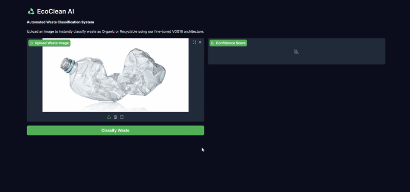
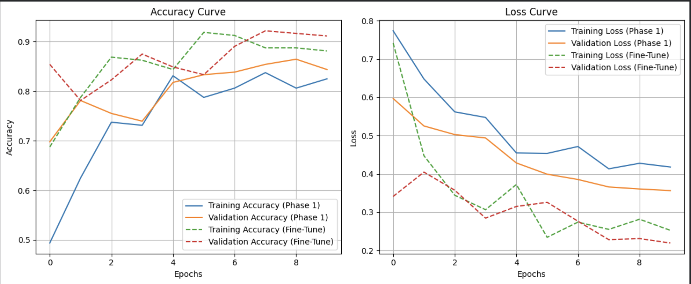

# EcoClean Waste Classification

EcoClean is an educational computer vision project that classifies waste images as **Organic** or **Recyclable**. The training notebook uses transfer learning with VGG16 and TensorFlow/Keras.

## Demo



The GIF shows a sample prediction from the waste classifier.

## Approach

The notebook resizes images to 150 x 150 pixels, scales pixel values to the 0–1 range, and applies data augmentation. It first trains a classification head on a frozen VGG16 base, then fine-tunes the final convolutional block. A sigmoid output produces the binary classification.

## Training Results

A previously captured evaluation run reported the following results on 100 test images. Rerun the corrected notebook evaluation cell to produce a fresh report:

| Metric | Result |
| --- | ---: |
| Test accuracy | 83% |
| Macro precision | 0.83 |
| Macro recall | 0.83 |
| Macro F1 score | 0.83 |



## Retraining

This repository does not include a dataset. To retrain the notebook, provide your own waste-classification images. You can use a relevant Kaggle dataset if its license permits your intended use. Follow the dataset provider's terms and attribution requirements.

For this notebook's two-class model, organize the images as follows:

```text
waste_dataset/
├── train/
│   ├── O/  # Organic images
│   └── R/  # Recyclable images
└── test/
    ├── O/
    └── R/
```

Place this folder next to the notebook, then run the cells from the beginning. If your dataset uses different class names or folder structure, update the notebook paths and labels accordingly.

## Repository Contents

- [`Welcome_to_Colab.ipynb`](Welcome_to_Colab.ipynb) — data preparation, model training, fine-tuning, and evaluation.
- [`live_demo.gif`](live_demo.gif) — recording of the interactive classifier.
- [`training_results.png`](training_results.png) — training history visualization.
- [`LICENSE`](LICENSE) — license for this repository's project materials.

## Pretrained Model Attribution

This project uses VGG16 ImageNet weights ported by Keras from the model released by Karen Simonyan and Andrew Zisserman of the University of Oxford Visual Geometry Group. The original VGG model is licensed under [CC BY 4.0](https://creativecommons.org/licenses/by/4.0/). The weights are fine-tuned for this waste-classification task. See the [Oxford VGG project](https://www.robots.ox.ac.uk/~vgg/research/very_deep/) and [Keras model-weight license notes](https://github.com/fchollet/deep-learning-models#license).

## Technology

Python, TensorFlow/Keras, VGG16, NumPy, scikit-learn, and Matplotlib.
